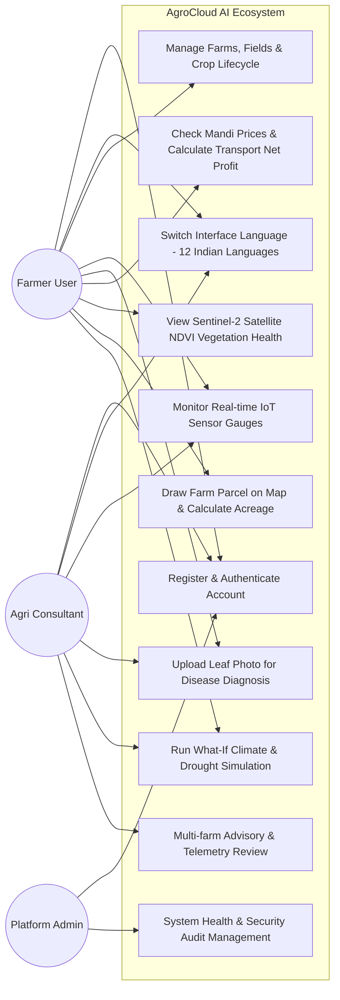
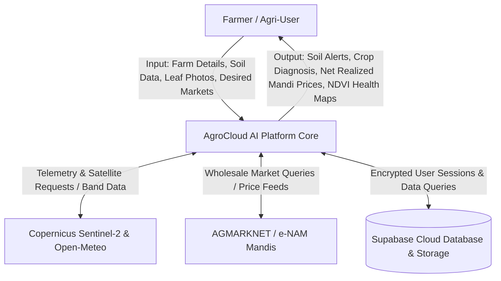
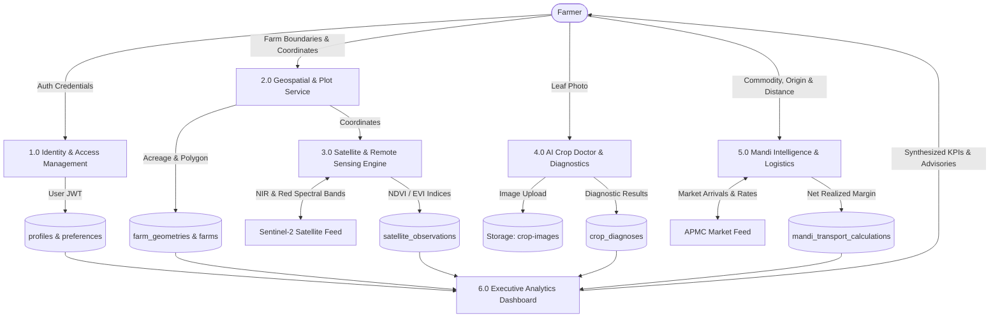
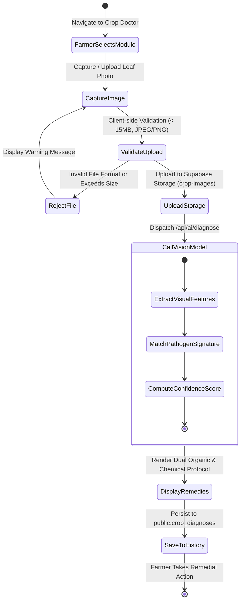
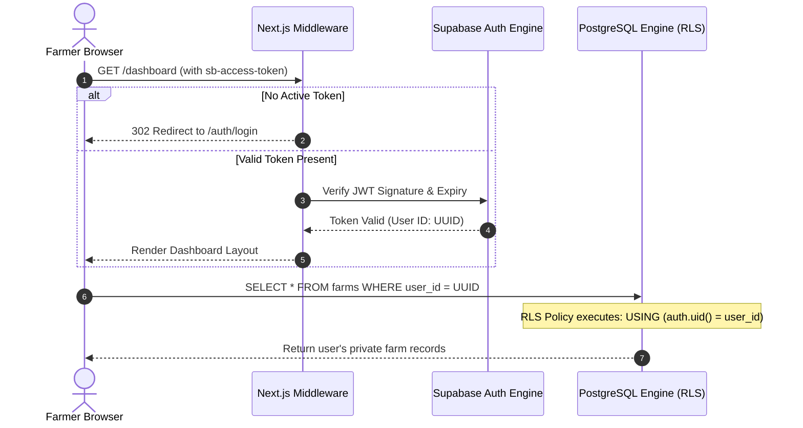
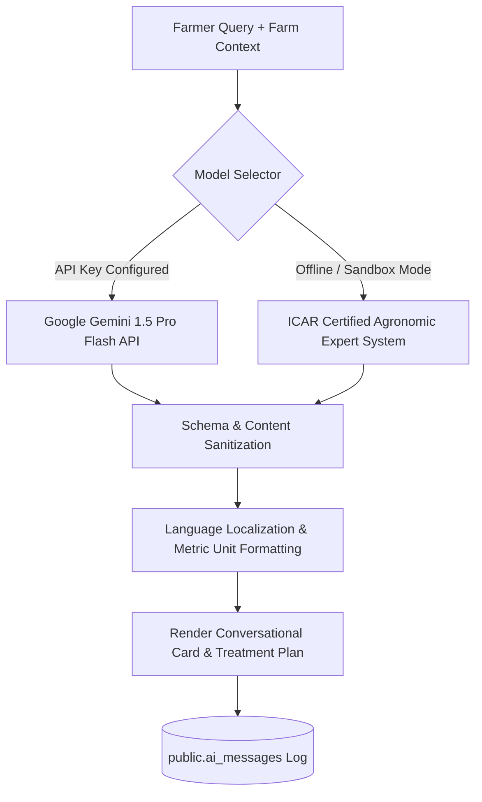
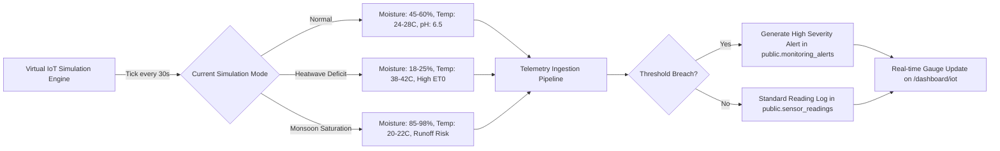
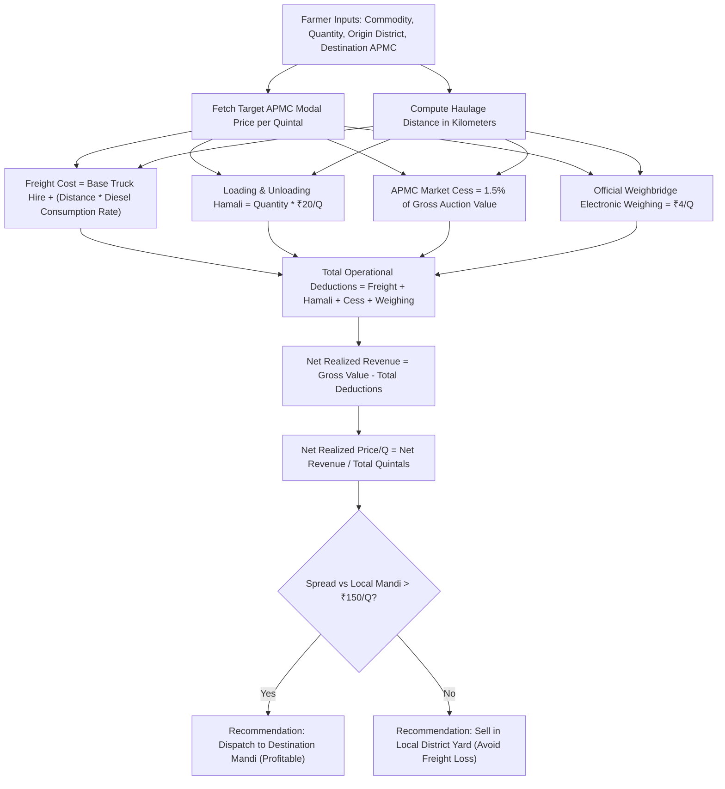

# AgroCloud AI – Comprehensive System Architecture & Engineering Specifications

**Platform:** AgroCloud AI – Cloud-Native Multilingual Smart Agricultural Ecosystem  
**Target Audience:** Smallholder Farmers, Agri-Enterprises, APMC Traders, and Agronomists  
**Core Stack:** Next.js 14 (App Router), TypeScript 5.7, Tailwind CSS, PostgreSQL 15, Supabase, Leaflet, Recharts  

---

## 1. Overall System Architecture Diagram

```mermaid
graph TB
    subgraph Client Tier [Client Tier - Responsive Web & Mobile PWA]
        Browser[Modern Web Browser / Mobile Device]
        I18nEngine[12-Language i18n Localization Engine]
        ThemeEngine[Tailwind CSS Emerald Design System]
    end

    subgraph Application Tier [Next.js 14 App Router - Fullstack Edge Server]
        AuthRouting[Auth & Protected Layout Middleware]
        UIRoutes[Dashboard, Farms, IoT, Mandi, AI, Satellite Views]
        APIRoutes[RESTful Route Handlers: /api/ai/* & /api/mandi/*]
    end

    subgraph Computation & Service Layer [Mathematical & Agronomic Engines]
        GeoService[Geospatial Service: Spherical Shoelace Geodesic Engine]
        SatService[Satellite Service: Sentinel-2 NDVI/EVI Spectral Math]
        MandiEngine[Mandi Service: Freight, Cess & Realized Profit Engine]
        SimEngine[Farm Simulator: FAO-56 Penman-Monteith Evapotranspiration]
        MLService[Predictive Analytics: 14-Day Stress & Yield Forecasts]
    end

    subgraph Cloud Persistence Tier [Supabase Enterprise Backend]
        SupaAuth[Supabase Auth: JWT & Session Management]
        PostgresDB[(PostgreSQL 15: 30 Relational Tables)]
        RLSEngine[Row Level Security Engine: auth.uid() Tenant Isolation]
        StorageBuckets[Storage: crop-images & drone-surveys Buckets]
    end

    subgraph External Data & AI Feeds [External Intelligence Feeds]
        OpenMeteo[Open-Meteo Hyperlocal Weather API]
        Agmarknet[AGMARKNET / e-NAM / data.gov.in Mandi Feeds]
        Copernicus[ESA Copernicus Sentinel-2 MSI Satellite API]
        GeminiLLM[Google Gemini 1.5 Pro / Built-in Agronomy Rules]
    end

    Browser --> I18nEngine & ThemeEngine
    Browser --> AuthRouting --> UIRoutes
    UIRoutes --> APIRoutes
    APIRoutes --> GeoService & SatService & MandiEngine & SimEngine & MLService

    GeoService & SatService & MandiEngine & SimEngine & MLService --> PostgresDB & StorageBuckets
    AuthRouting --> SupaAuth
    PostgresDB --> RLSEngine

    APIRoutes --> OpenMeteo & Agmarknet & Copernicus & GeminiLLM
```

---

## 2. Database Entity-Relationship (ER) Diagram

```mermaid
erDiagram
    users ||--o{ profiles : "has identity"
    users ||--o{ user_preferences : "configures"
    users ||--o{ farms : "owns"
    
    farms ||--o{ fields : "contains"
    fields ||--o{ crops : "grows"
    farms ||--o{ farming_activities : "logs"
    farms ||--o{ farming_expenses : "records"
    
    farms ||--o{ iot_sensors : "deploys"
    iot_sensors ||--o{ sensor_readings : "transmits"
    farms ||--o{ sensor_simulations : "simulates"
    farms ||--o{ monitoring_alerts : "triggers"
    farms ||--o{ irrigation_recommendations : "receives"
    
    users ||--o{ ai_conversations : "participates"
    ai_conversations ||--o{ ai_messages : "contains"
    users ||--o{ crop_diagnoses : "uploads"
    farms ||--o{ yield_predictions : "projects"
    farms ||--o{ ai_farm_insights : "generates"
    
    mandi_records ||--o{ mandi_price_history : "tracks"
    users ||--o{ farmer_mandi_watchlists : "monitors"
    farms ||--o{ mandi_transport_calculations : "evaluates"
    
    farms ||--o{ farm_geometries : "bounds"
    farms ||--o{ satellite_observations : "monitors"
    farms ||--o{ drone_uploads : "surveys"
    drone_uploads ||--o{ drone_analyses : "evaluates"
    
    farms ||--o{ farm_simulation_scenarios : "runs"
    farms ||--o{ predictive_insights : "synthesizes"
```



---

## 3. System Use Case Diagram



---

## 4. Data Flow Diagrams (DFD)

### 4.1 DFD Level 0 (Context Diagram)


### 4.2 DFD Level 1 (Decomposition Diagram)


---

## 5. Activity Diagram (Crop Diagnosis & Advisory Workflow)



---

## 6. Authentication & Session Sequence Diagram



---

## 7. AI Agronomy Processing Workflow



---

## 8. Virtual IoT Monitoring Workflow



---

## 9. Mandi Intelligence & Logistics Profitability Workflow


